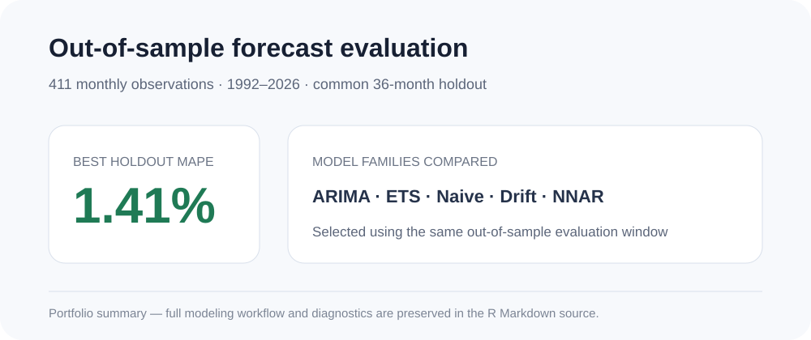

# U.S. Retail Sales Forecasting

<p align="center">
  <strong>Comparative time-series forecasting of monthly U.S. retail sales with out-of-sample model validation.</strong>
</p>

<p align="center">
  
  
  
</p>

<p align="center">
  
</p>

## Overview

This project evaluates multiple forecasting approaches on **411 monthly U.S. retail sales observations spanning 1992–2026**.

Rather than selecting a model from in-sample fit alone, the analysis uses a **36-month holdout period** and compares forecast accuracy across classical statistical baselines and a neural-network autoregression model.

The best-performing specification achieved **1.41% MAPE** on the holdout period.

## Modeling Workflow

```text
monthly retail sales
  → exploratory time-series analysis
  → transformation / differencing diagnostics
  → candidate forecasting models
  → 36-month holdout evaluation
  → out-of-sample accuracy comparison
  → final forecast + practical interpretation
```

## Models Compared

- ARIMA / automatic ARIMA specifications
- Exponential Smoothing (ETS)
- Naive forecast
- Random walk with drift
- Neural Network Autoregression (NNAR)

## Evaluation

The project emphasizes **out-of-sample forecasting performance** rather than choosing a model solely from in-sample diagnostics.

**Key result:** best holdout MAPE = **1.41%**.

The 36-month test window provides a common evaluation period for comparing models under the same forecasting task.

## Business Relevance

Retail forecasts can support decisions such as:

- inventory planning
- staffing and capacity planning
- budgeting
- purchasing and supply-chain preparation

These applications are interpretive examples rather than claims that the model alone determines operational decisions.

## Repository Structure

```text
retail-sales-forecasting/
├── README.md
├── analysis/
│   └── Final_Project.Rmd
└── figures/
    └── evaluation_summary.svg
```

## Reproduce the Analysis

Open `analysis/Final_Project.Rmd` in RStudio and run the document from top to bottom with the packages and data source specified in the original analysis.

The Rmd is preserved as the project source so the modeling decisions, diagnostics, and forecast evaluation remain auditable.

## Limitations

- Forecast accuracy is evaluated on one historical holdout window.
- Retail behavior may shift under structural changes not represented in the training period.
- MAPE is easy to interpret but is only one forecast-accuracy metric.
- Forecasts should be refreshed as new observations become available.

---

<sub>Independent time-series project, 2026.</sub>
