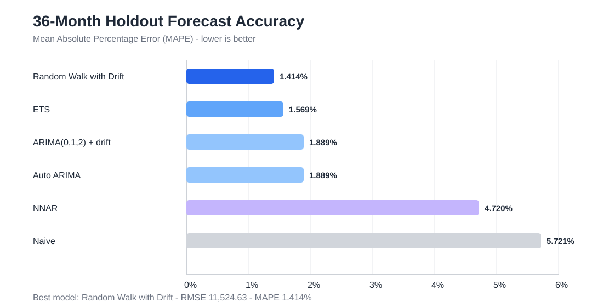

# U.S. Retail Sales Forecasting

<p align="center">
  <strong>Time-series forecasting of monthly U.S. retail and food-services sales using statistical, baseline, and neural forecasting models.</strong>
</p>

<p align="center">
  
  
  
</p>

<p align="center">
  
</p>

## Overview

This project analyzes **411 monthly observations** of seasonally adjusted U.S. retail and food-services sales from **January 1992 through March 2026**.

The analysis moves from stationarity diagnostics and ARIMA identification to a broader out-of-sample forecast competition. The last **36 months** are held out for evaluation so model selection is based on forecast performance rather than in-sample fit alone.

The strongest result was intentionally simple: a **random walk with drift** achieved the lowest holdout error with **1.414% MAPE**, outperforming ETS, ARIMA, NNAR, and naive baselines.

## Forecast Competition

| Model | RMSE | MAPE |
|---|---:|---:|
| **Random Walk with Drift** | **11,524.63** | **1.414%** |
| ETS | 12,862.62 | 1.569% |
| Manual ARIMA(0,1,2) + drift | 15,580.30 | 1.889% |
| Auto ARIMA | 15,580.30 | 1.889% |
| Neural Network Autoregression | 38,962.54 | 4.720% |
| Naive | 46,561.17 | 5.721% |

## Analytical Workflow

```text
Monthly retail sales
  → log transformation
  → stationarity checks
  → first differencing
  → ACF / PACF inspection
  → candidate ARIMA models
  → residual diagnostics
  → 36-month holdout
  → expanded model competition
  → out-of-sample model selection
```

## Methods

- time-series visualization and exploratory diagnostics
- Augmented Dickey-Fuller testing
- log transformation and first differencing
- ACF / PACF analysis
- manual ARIMA model comparison with AICc and BIC
- automatic ARIMA benchmarking
- residual diagnostics and Ljung-Box testing
- naive and random-walk-with-drift baselines
- ETS forecasting
- neural-network autoregression (NNAR)
- 36-month out-of-sample evaluation using RMSE, MAE, and MAPE

## Key Findings

- The original retail-sales series is strongly trending and nonstationary.
- Log transformation alone does not remove the unit-root behavior; first differencing produces a much more stable series.
- ARIMA(0,1,2) with drift is the strongest manual ARIMA candidate by information criteria.
- Residual diagnostics still show stress around major structural shocks, particularly the COVID-era disruption.
- On the 36-month holdout, the random walk with drift outperforms the more complex alternatives.
- The result illustrates an important forecasting principle: **greater model complexity does not guarantee better out-of-sample accuracy**.

## Repository Structure

```text
retail-sales-forecasting/
├── README.md
├── analysis/
│   └── retail_sales_forecasting.Rmd
└── figures/
    └── model_comparison.svg
```

## Data Source

The analysis uses the U.S. Census Bureau's **Monthly Retail Trade Survey**, seasonally adjusted retail and food-services sales series. The R Markdown source retrieves the public data directly from the Census Bureau.

## Reproducibility

The source analysis is in [`analysis/retail_sales_forecasting.Rmd`](analysis/retail_sales_forecasting.Rmd).

Primary R packages:

- `tidyverse`
- `forecast`
- `tseries`
- `astsa`

## Limitations

- The series is aggregate national retail sales and does not capture industry- or region-specific dynamics.
- Structural shocks such as the COVID period are difficult for standard forecasting models to absorb.
- The evaluation uses a single 36-month holdout rather than rolling-origin cross-validation.
- Forecast accuracy does not imply causal explanation.

---

<sub>Independent graduate time-series project, 2026.</sub>
